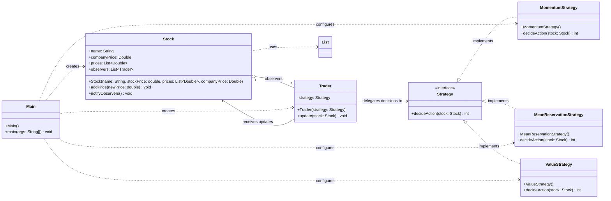

# UML Class Diagram

The following class diagram represents all interfaces, classes, fields, methods, and associations currently in the `hw` project.

## Relationship Notes

- `Strategy` is the common interface for all trading algorithms.
- Each concrete strategy implements `decideAction(Stock)`.
- `Trader` has one `Strategy` and delegates its decision to that strategy.
- `Stock` maintains zero or more `Trader` observers and calls `update(Stock)` when notified.
- `Main` creates and connects the objects, then adds new prices and publishes notifications.
- The `Stock` to `Trader` association is shown as one stock to many observers.
